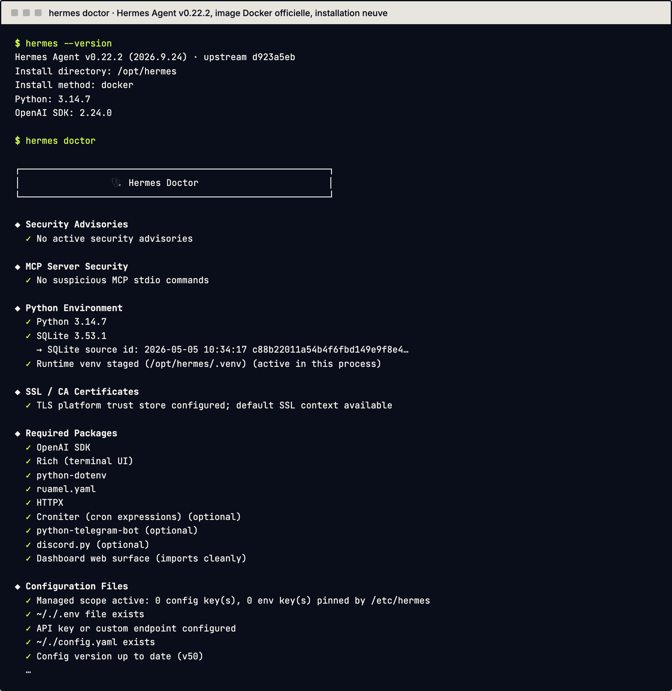

# 1. Installer Hermes Agent

Ce chapitre vous mène de zéro à un Hermes qui répond : choisir la machine, lancer l'installation, vérifier, puis savoir mettre à jour sans mauvaise surprise.

## Sur quels systèmes Hermes tourne-t-il ?

La doc classe les systèmes en deux niveaux. Le niveau 1 est celui que l'équipe d'Hermes s'efforce de ne jamais casser.

| Système | Méthode d'installation | À savoir |
|---|---|---|
| Mac avec puce Apple Silicon | application Hermes Desktop, ou `install.sh` | Niveau 1 |
| Windows 10 / 11 | `install.ps1`, ou paquet MSIX | Le paquet MSIX demande Windows 11 22H2 ou plus récent |
| Linux ou WSL2 | `install.sh` | Testé sur la dernière Ubuntu ; une distribution avec glibc, systemd et la hiérarchie standard de fichiers (FHS) devrait bien convenir |
| Docker | image officielle | `hermes update` ne fonctionne pas : on met à jour en lançant une nouvelle image |

Au niveau 2 (maintenance au mieux) : Nix et Android avec Termux (la page Termux de la doc le dit actuellement cassé, voir chapitre 10). Ne sont pas pris en charge : l'installation par `pip`, `brew` ou AUR.

Piège : pour un Mac Intel, la doc se contredit un peu. La page d'installation dit que l'installeur Mac est réservé à Apple Silicon, et la page de support décrit un paquet Desktop séparé pour Intel. Si vous avez un Mac Intel, relisez la page « Platform Support » avant de commencer.

## De quoi a-t-on besoin avant de commencer ?

Pour le script d'installation sous Mac et Linux, il faut Git, curl, tar et un outil de somme de contrôle SHA-256. Sous Windows, le script peut récupérer lui-même Git s'il manque. Les installations actuelles utilisent Python 3.14, mais le script apporte son propre interpréteur : vous n'avez pas à l'installer.

## Quelle est la commande d'installation ?

Sous Mac, Linux ou WSL2 :

```bash
curl -fsSL https://hermes-agent.nousresearch.com/install.sh | bash
```

Sous Windows (PowerShell) :

```powershell
iex (irm https://hermes-agent.nousresearch.com/install.ps1)
```

Les scripts récupèrent le code, préparent l'environnement Python et les outils, créent la commande `hermes` et le dossier de données. Sur Mac et Linux, la commande est dans `~/.local/bin/hermes` et vos données dans `~/.hermes/`. Un journal détaillé est écrit dans `logs/install.log` sous ce dossier de données.

N'utilisez pas `sudo` avec l'installeur : la doc précise qu'il s'installe dans `~/.local/bin`.

Si vous préférez une application graphique, la doc propose aussi des paquets Desktop pour Mac et Windows, téléchargeables depuis le site officiel d'Hermes. Ce guide suit la ligne de commande.

## Comment vérifier que l'installation a marché ?

Rechargez votre terminal, puis testez :

```bash
source ~/.zshrc    # ou : source ~/.bashrc
hermes --version
hermes doctor
```

`hermes --version` affiche la version. `hermes doctor` contrôle la configuration et les dépendances, et dit ce qui manque. Si `hermes` reste introuvable, voir le chapitre 8.



*Sortie réelle, sur une installation neuve (image Docker officielle, v0.22.2). Un `⚠` signale un point à régler ; la rubrique « Required Packages » est celle à relire après une mise à jour.*

## Que se passe-t-il au premier lancement ?

Lancez simplement :

```bash
hermes
```

Sur une installation neuve, l'assistant (`hermes setup`) propose trois modes : une configuration rapide par abonnement, une configuration complète où vous apportez vos propres clés, et un mode « Blank Slate » où presque tout est désactivé au départ (modèle, fichiers et terminal seulement). Pour une première fois, la configuration complète est la plus lisible : elle vous fait choisir le fournisseur de modèle, ce qu'explique le chapitre 2.

Vous pourrez retoucher chaque réglage plus tard, sans tout refaire :

```bash
hermes model          # fournisseur et modèle
hermes tools          # outils activés
hermes gateway setup  # messageries (Telegram, etc.)
hermes setup          # l'assistant complet
```

Règle de la doc : si Hermes ne tient pas une conversation normale, n'ajoutez rien d'autre. Obtenez d'abord un échange propre, puis branchez la messagerie et les tâches programmées. Vérifiez aussi que la reprise fonctionne avec `hermes --continue`, qui rouvre la dernière session.

## Quelle machine choisir ?

Deux cas.

- **Vous parlez à l'agent depuis votre poste, quand vous travaillez.** Votre ordinateur suffit.
- **L'agent doit travailler seul** (répondre sur une messagerie, lancer des tâches programmées). Il faut alors une machine allumée en permanence. La passerelle (gateway), le processus qui relie Hermes à Telegram ou à d'autres messageries, doit tourner. Les tâches programmées sont déclenchées par la passerelle : une simple session de discussion dans un terminal ne les lance pas.

Sur Mac ou Linux, la passerelle peut s'installer comme service de fond avec `hermes gateway install`, puis `hermes gateway start`. Sous WSL2, la page de démarrage dédiée recommande d'activer systemd (fichier `/etc/wsl.conf`, puis `wsl --shutdown`) avant d'installer le service ; sans systemd, lancez la passerelle au premier plan avec `hermes gateway run`, par exemple dans `tmux`. La FAQ officielle, plus ancienne, dit encore que systemd y est peu fiable : suivez la page WSL. Sous Android, le système peut arrêter les processus en arrière-plan : à éviter pour un agent autonome. Sur Linux, un service qui doit survivre à la déconnexion demande `loginctl enable-linger` (à lancer par un administrateur).

## Comment mettre à jour ?

Pour une installation par script (le cas décrit ici) :

```bash
hermes update --check   # voir s'il y a une mise à jour, sans rien installer
hermes update --plan    # voir ce qui tourne et comment ce sera redémarré, sans rien changer
hermes update           # mettre à jour
```

Avant de toucher au code, `hermes update` sauvegarde des fichiers d'état (configuration, clés, tâches programmées) dans `state-snapshots/`. Pour une sauvegarde complète, ajoutez `--backup`. Ensuite il met à jour le code, prépare les dépendances, propose de migrer la configuration, puis redémarre les passerelles en cours. Ce redémarrage attend la fin des tâches en cours : il peut durer un moment.

Depuis une messagerie, la commande `/update` fait la même chose. Les installations par application, Docker, Nix et Termux se mettent à jour par leur propre mécanisme, détaillé dans la page « Updating & Uninstalling ».

## Que vérifier après une mise à jour ?

La doc recommande cette séquence :

```bash
git status --short       # dans ~/.hermes/hermes-agent : l'arbre doit être propre
hermes doctor
hermes --version
hermes gateway status    # si vous utilisez la passerelle
hermes pm status         # état de la préparation des dépendances
```

Si la configuration a changé, `hermes config check` liste ce qui manque et `hermes config migrate` l'ajoute.

> **Sur le terrain (octobre 2026).** Chez nous, après une mise à jour (`hermes update`), l'environnement Python des outils a été réinstallé et un paquet a disparu : un outil s'est arrêté sans bruit, jusqu'à ce que le contrôle quotidien le signale. Depuis, on vérifie après chaque mise à jour. Un `hermes gateway restart` a aussi parfois été nécessaire pour que la configuration soit prise en compte.

## Sources

- https://hermes-agent.nousresearch.com/docs/getting-started/installation
- https://hermes-agent.nousresearch.com/docs/getting-started/quickstart
- https://hermes-agent.nousresearch.com/docs/getting-started/platform-support
- https://hermes-agent.nousresearch.com/docs/getting-started/updating
- https://hermes-agent.nousresearch.com/docs/guides/cron-troubleshooting
- https://hermes-agent.nousresearch.com/docs/reference/faq
